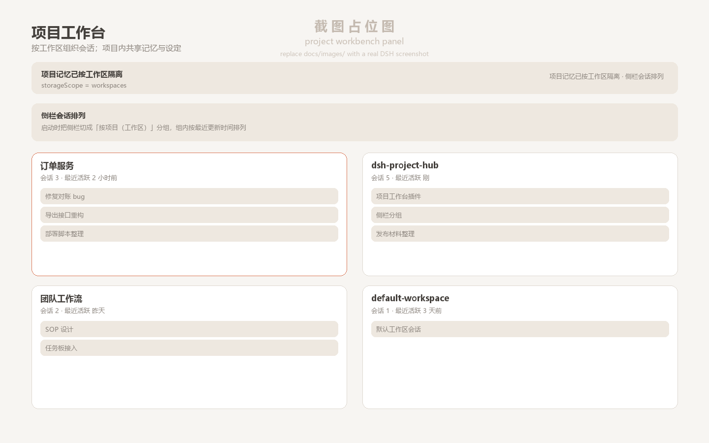
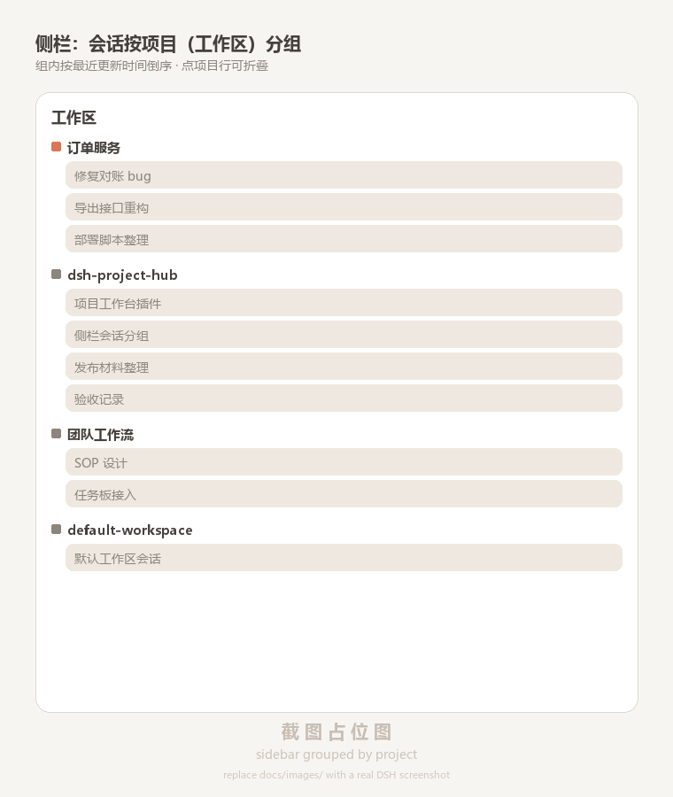

# dsh-project-hub (Project Workbench)

English | [中文](README.md)

A Web client plugin for [DeepSeek Harness (DSH)](https://github.com/deepseek-ai/deepseek-harness) that **organises sessions around projects** — one project = one workspace directory. Sessions inside a project share memory, default settings and rules, and the sidebar groups conversations by project.

[](LICENSE)
[](https://github.com/deepseek-ai/deepseek-harness)
[](#compatibility)



## Why

DSH can already group sessions by workspace, but project boundaries are still thin:

- **Memory is global**: one `MEMORY.md` for every project, so preferences leak across projects;
- **Model / reasoning / preset are profile-wide**: they do not follow the project you are in;
- **No project workbench**: to start a feature in another repo you have to pick the folder yourself and re-state conventions.

This plugin fills those gaps without touching DSH internals or session data:

| Capability | How |
|---|---|
| Project workbench | New top-level panel + sidebar entry, projects sorted by recent activity |
| Per-project defaults | description / preset / model / reasoningEffort stored per `workspaceId`; applied when creating from the panel |
| Per-project memory | Switches Mnemon `storageScope=workspaces`; `USER.md` stays global |
| Rules preview | Reuses the official `AGENTS.md` / `CLAUDE.md` discovery order, read-only |
| Sidebar ordering | Switches the sidebar to the official "group by workspace" mode at startup, newest sessions first inside a group |

## Screenshots

| Sidebar grouped by project | Project workbench |
|---|---|
|  |  |

## Features

- **Project cards**: name, path (click to copy), session count, last activity, description, default preset/model/reasoning badges;
- **Session list**: newest first, click to open;
- **New session**: creates in the project directory, applies the project defaults, then opens it;
- **Settings**: edit description and defaults (stored in `<profile>/.dsh-project-hub/state.json`, keyed by workspace id);
- **Project rules**: preview `AGENTS.md` / `CLAUDE.md` in the official discovery order (global → project root, including `.local` overlays);
- **Memory bar**: shows the current scope; one click to isolate per project, one click to roll back to a shared memory;
- **Sidebar ordering**: "Group by project" to re-apply instantly; "Leave as is" disables the automatic switch (preference lives in the plugin's own localStorage, default on). With the Claude Code style skin installed, the plugin also turns its date view (Today / Yesterday / weekday sections) off first.

## Install

### Requirements

- DeepSeek Harness `0.2.x` (`engines.dsh = ">=0.2.0-rc.2 <0.3.0-0"`, tested on **0.2.2-rc.1 desktop**);
- A DSH profile (the desktop app uses `desktop`).

### Option A — `plugin_manager`

Clone the repository, then run inside DSH:

```text
plugin_manager(action="install_bundle", target="<absolute path to this repository>")
```

### Option B — DSH CLI

```powershell
git clone https://github.com/<your-github-name>/dsh-project-hub.git
dsh plugin --profile desktop add "link:<absolute path to this repository>"
```

After installing:

1. the host is recomposed and the host half is hot-loaded;
2. **refresh the Web GUI page once** — the "Projects" entry appears in the sidebar (client plugins load with the page);
3. runtime check (use your local DSH Web GUI port):

```powershell
curl http://127.0.0.1:<port>/dsh-project-hub/api/health
```

`client.registered = true` means the client bundle is registered; `memory.storageScope` and `clientEvents.last` show whether the panel actually rendered.

## Usage

1. **Memory isolation**: open the Projects panel and click "Isolate memory per project" — this writes `storageScope=workspaces` through the official settings service and takes effect immediately; "Share one global memory" rolls it back.
2. **Project defaults**: project card → Settings, fill in description / preset / model / reasoning, save.
3. **New session per project**: project card → New session — the session's cwd is the project directory and the defaults are applied automatically.
4. **Rules**: project card → Project rules — hierarchical rule files with excerpts, in the official order.
5. **Sidebar grouping**: applied at startup by default. To opt out, click "Leave as is" in the sidebar-ordering bar; afterwards use the sidebar's own "View options" to switch freely.

## Compatibility

- Tested on DSH `0.2.2-rc.1` desktop (Windows, Electron, `dsh-app://` page);
- Plain Web profiles should work too. On desktop the HTTP routes go through the host auth gate; the plugin skips the browser-credential check for the desktop profile the same way the official `dshmarket` plugin does (`/health` is a loopback-only diagnostic endpoint);
- The official `sidebar.workspaces` slot is **not** replaced; grouping is switched via `uiWorkspace.view.setGroupBy()`;
- The Claude Code style skin (`dsh-claude-style`) forces a flat date view on every page load; the plugin integrates via its `dsh-claude-toggle-date-view` event plus the body attribute. If a skin update changes that contract, the worst case is "grouping applied once at startup".

## Known limitations

- No moving sessions between projects (DSH has no such RPC and cwd is immutable after creation);
- No built-in editor — rules and memory are read-only previews;
- Permission modes are deliberately not part of per-project settings (auto-escalation has security implications);
- Project metadata is stored in the profile, never written into user repositories.

## Development

Zero build chain: the host half is plain ESM JavaScript, the client half is a hand-written `__ModuleLoader__` single-file bundle (only `require("react")`).

```powershell
node --check lib/state.js lib/index.js client/client.js
node scripts/test-host.mjs                                  # host contract, 21 checks
node scripts/test-client.mjs client/client.js               # bundle load/registration smoke
node scripts/test-client-interaction.mjs client/client.js   # panel interaction flow
# real React 18 + jsdom offscreen render (deps installed to a temp dir, see the script header)
$env:PH_RENDER_MODULES="$env:TEMP\ph-render"; node scripts/test-client-dom.mjs client/client.js  # 16 checks
```

- Design decisions: [docs/设计结论.md](docs/设计结论.md) (Chinese)
- Host ↔ client HTTP contract: [docs/接口约定.md](docs/接口约定.md) (Chinese)
- Acceptance evidence: [docs/验收记录.md](docs/验收记录.md) (Chinese)

### Layout

```
package.json          # plugin manifest: dsh.bundle.patch / dsh.client / engines.dsh / icon / locale
cordis.patch.yml      # bundle layer: inserts the plugin into the loader
lib/index.js          # host cordis plugin: state store + HTTP routes + memory scope
lib/state.js          # state store and rule discovery (pure functions)
client/client.js      # web client bundle: project panel + sidebar entry
locale/{zh,en}.json   # plugin metadata for the plugin manager
icon.svg              # plugin icon
docs/                 # design notes, contract, acceptance log, screenshots
scripts/              # self-check scripts and a read-only asar extractor
```

## Contributing

See [CONTRIBUTING.md](CONTRIBUTING.md). For security issues, please follow [SECURITY.md](SECURITY.md).

## License

[MIT](LICENSE)
