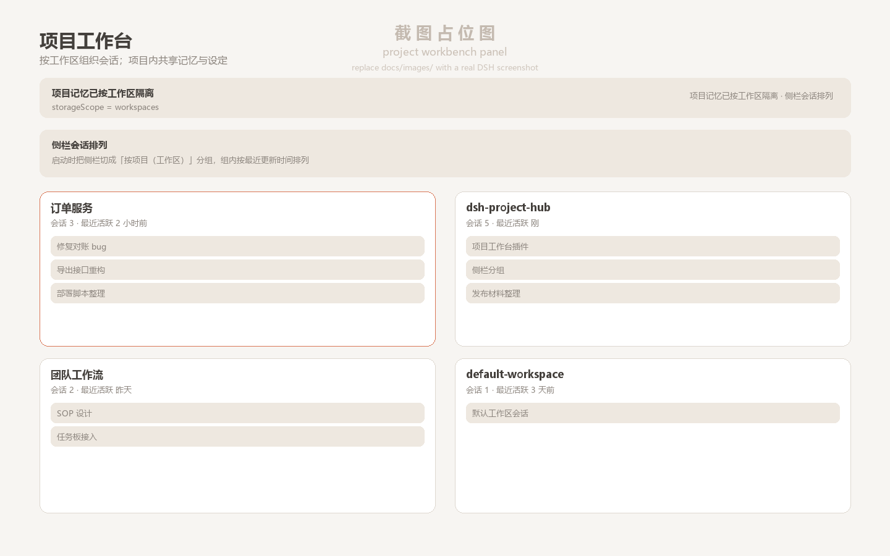
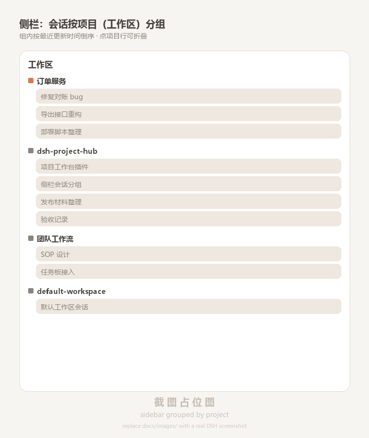

# dsh-project-hub（项目工作台）

[English](README.en.md) | 中文

给 [DeepSeek Harness（DSH）](https://github.com/deepseek-ai/deepseek-harness) 的 Web 客户端插件：**把「项目」作为组织会话的单位**——一个项目 = 一个工作区目录，项目内所有会话共享记忆、默认设置与规则，侧栏会话也按项目分组。

[](LICENSE)
[](https://github.com/deepseek-ai/deepseek-harness)
[](#兼容性)
[](https://github.com/<your-github-name>/dsh-project-hub/actions/workflows/ci.yml)



## 它解决什么

DSH 原生已经能按工作区（workspace）分组显示会话，但项目之间的边界仍然薄弱：

- **记忆是全局一份**：所有项目的经验混在一起，A 项目的偏好会污染 B 项目；
- **模型 / 推理强度 / preset 是 profile 级**：换项目不会换默认设置，每次都要重新选；
- **没有「项目工作台」入口**：新建会话要自己选目录，项目约定（`AGENTS.md`）只能靠记忆。

本插件补上这三块，同时不修改 DSH 核心、不动会话数据：

| 能力 | 做法 |
|---|---|
| 项目工作台视图 | 新增顶层面板 + 侧栏「项目」入口，按最近活跃列出项目卡片与会话 |
| 项目级默认设置 | 每个项目可存 description / preset / model / reasoningEffort，新建会话自动套用 |
| 项目记忆隔离 | 切换 Mnemon `storageScope=workspaces`，按工作区分目录存记忆，`USER.md` 保持全局 |
| 项目规则预览 | 复用官方 `AGENTS.md` / `CLAUDE.md` 发现顺序，只读预览，不另造指令文件 |
| 侧栏会话排列 | 启动时把侧栏切到官方「按工作区（项目）」分组，组内按最近更新时间倒序 |

## 截图

| 侧栏按项目分组 | 项目工作台 |
|---|---|
|  |  |

## 功能

打开侧栏的「项目」入口，就是项目工作台：

- **项目卡片**：名称、路径（点击复制）、会话数、最近活跃、项目描述、默认 preset / 模型 / 推理强度徽标；
- **会话列表**：按最近活动倒序，点击直接打开；
- **新建会话**：在项目目录里开新会话，自动套用该项目的默认 preset / 模型 / 推理强度；
- **设置**：编辑项目描述与默认设置（存 `<profile>/.dsh-project-hub/state.json`，键 = workspaceId）；
- **项目规则**：按官方发现顺序预览 `AGENTS.md` / `CLAUDE.md`（全局 → 项目根，含 `.local` 叠加）；
- **记忆状态条**：显示当前记忆作用域，未隔离时一键切换为按项目隔离，也可一键改回全局共享；
- **侧栏会话排列**：「按项目分组」立即切一次；「不干预」关闭启动时的自动切换（偏好存在插件自己的 localStorage，默认开）。如果装了 Claude Code 风格皮肤，插件会先关掉它的「日期视图」（今天/昨天/星期几分段）再切分组。

## 安装

### 前提

- DeepSeek Harness `0.2.x`（`engines.dsh = ">=0.2.0-rc.2 <0.3.0-0"`，已在 **0.2.2-rc.1 桌面版**实测）；
- 一个 DSH profile（桌面应用默认 `desktop`）。

### 方式一：`plugin_manager`（推荐）

把本仓库克隆到本地任意目录，然后在 DSH 里执行：

```text
plugin_manager(action="install_bundle", target="<本仓库绝对路径>")
```

### 方式二：DSH CLI

```powershell
git clone https://github.com/<your-github-name>/dsh-project-hub.git
dsh plugin --profile desktop add "link:<本仓库绝对路径>"
```

安装后：

1. 宿主会经 HMR 重组并热加载 host 侧；
2. **刷新一次 Web GUI 页面**，侧栏会出现「项目」入口（client 插件在页面启动时加载）；
3. 运行期自检（端口以你本机 DSH Web GUI 为准）：

```powershell
curl http://127.0.0.1:<port>/dsh-project-hub/api/health
```

返回 `client.registered = true` 即客户端 bundle 已被收录；`memory.storageScope` 与 `clientEvents.last` 可用于确认面板实际渲染。

## 使用

1. **切换记忆隔离**：打开「项目」面板，顶部记忆条点「启用按项目记忆隔离」——底层调用官方设置服务写入 `storageScope=workspaces`，原地生效；想回滚就点「改回全局共享」。
2. **配置项目默认值**：项目卡片 →「设置」，填描述与默认 preset / 模型 / 推理强度，保存后立即生效。
3. **按项目开新会话**：项目卡片 →「新建会话」，新会话的 cwd 就是项目目录，并自动套用默认设置、跳转到会话。
4. **看规则**：项目卡片 →「项目规则」，按官方顺序列出层级规则文件并预览片段。
5. **侧栏按项目分组**：默认启动即切换；若想用别的排法，在面板「侧栏会话排列」点「不干预」，之后可用侧栏「视图选项」自由切换。

## 兼容性

- 实测环境：DSH `0.2.2-rc.1` 桌面版（Windows，Electron + `dsh-app://` 页面）；
- 纯 Web profile 理论可用；桌面端 HTTP 请求会走宿主鉴权网关，插件已按官方 `dshmarket` 的做法在 desktop profile 下跳过浏览器凭证校验（`/health` 为回环免鉴权诊断接口）；
- 官方 `sidebar.workspaces` 槽位**不替换**，只通过 `uiWorkspace.view.setGroupBy()` 切换官方分组模式；
- Claude Code 风格皮肤（`dsh-claude-style`）的「日期视图」会每页重新打开并强制单列表，插件用它的 `dsh-claude-toggle-date-view` 事件 + body 属性兼容；皮肤若升级改动该契约，最多退化为「启动时切一次官方分组」。

## 已知限制

- 不做跨项目移动会话：DSH 没有该 RPC，会话 cwd 创建后不可变；
- 不做内置编辑器：规则/记忆只读预览；
- 权限模式不纳入项目级设定（自动提权有安全含义）；
- 项目元数据按 `workspaceId` 存在 profile 侧，不写入用户仓库。

## 开发

零构建链：host 是 ESM 纯 JS，client 是手写 `__ModuleLoader__` 单文件 bundle（只 `require("react")`）。

```powershell
node --check lib/state.js lib/index.js client/client.js
node scripts/test-host.mjs                                  # 宿主契约，21 项
node scripts/test-client.mjs client/client.js               # bundle 加载/注册冒烟
node scripts/test-client-interaction.mjs client/client.js   # 面板交互全链路
# 真实 React 18 + jsdom 离屏渲染（依赖装到临时目录，见脚本头注释）
$env:PH_RENDER_MODULES="$env:TEMP\ph-render"; node scripts/test-client-dom.mjs client/client.js  # 16 项
```

- 设计决策：[docs/设计结论.md](docs/设计结论.md)
- host ↔ client HTTP 契约：[docs/接口约定.md](docs/接口约定.md)
- 验收证据（真实页面信标 / leveldb / 测试）：[docs/验收记录.md](docs/验收记录.md)

### 目录结构

```
package.json          # 插件清单：dsh.bundle.patch / dsh.client / engines.dsh / icon / locale
cordis.patch.yml      # bundle 层：把插件插入加载器
lib/index.js          # host cordis 插件：状态存储 + HTTP 路由 + 记忆作用域
lib/state.js          # 状态存储与规则发现（纯函数，可单测）
client/client.js      # Web 客户端 bundle：项目工作台面板 + 侧栏入口
locale/{zh,en}.json   # 插件元数据（插件管理器展示用）
icon.svg              # 插件图标
docs/                 # 设计结论、接口约定、验收记录、截图
scripts/              # 自检脚本与 asar 只读提取工具
```

## 贡献

见 [CONTRIBUTING.md](CONTRIBUTING.md)。安全相关请按 [SECURITY.md](SECURITY.md) 私下报告。

## 许可证

[MIT](LICENSE)
